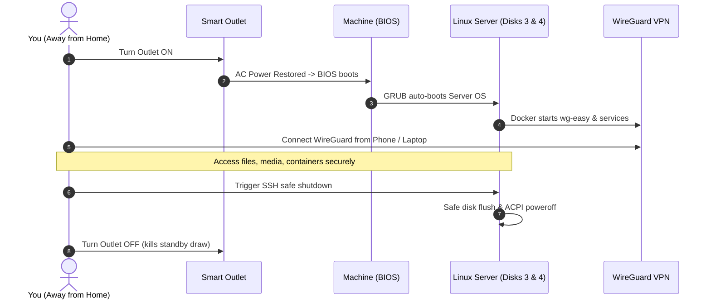

# Hybrid Gaming & On-Demand Home Server (Dual-Boot)

A documentation repository and operational guide for running a dual-purpose personal computer that operates as a **100% isolated Dual-Boot machine**:
* **Mode 1**: High-performance Windows Gaming Rig (Disks 1 & 2).
* **Mode 2**: On-Demand Linux Home Server (Disks 3 & 4), remotely powered via a Smart Outlet and secured through a self-hosted **WireGuard VPN**.

---

## 📌 Architecture Highlights

* **Isolation Level**: Complete hardware disk segregation.
  * **Disks 1 & 2 (NTFS)**: Windows 10/11 OS, games, and daily personal apps.
  * **Disks 3 & 4 (ext4/ZFS)**: Dedicated Linux Server OS, Docker containers, and storage pool. Windows cannot read or modify these filesystems natively.
* **Boot Management**: GRUB configured to auto-boot to **Linux Server** on smart plug power-on, with `grub-reboot` support for one-shot remote boots into Windows.
* **Remote Access**: Self-hosted WireGuard VPN (via `wg-easy` container) + Dynamic DNS (DDNS). No third-party network relays required.
* **Power Lifecycle**: Smart Outlet for boot trigger (BIOS *Restore on AC Power Loss*) paired with remote SSH software shutdowns to protect disk integrity.

---

## 📚 Documentation Index

1. [**01. Power & Remote Management**](docs/01-power-and-remote-control.md)
   * BIOS AC Restore configuration for smart plugs.
   * Graceful shutdown protocols vs abrupt power cut risks.
   * Wake-on-LAN (WoL) and PCIe switch alternatives.

2. [**02. Storage & Disk Allocation**](docs/02-storage-and-disk-architecture.md)
   * 4-Drive partitioning and physical isolation.
   * Redundancy strategies (Mirror / RAID 1 / ZFS mirror / JBOD + backup).
   * Filesystem choices and drive health protection.

3. [**03. Dual-Boot Architecture & OS Isolation Guide**](docs/03-operating-system-and-workflow.md)
   * Complete cross-OS disk isolation (ext4/ZFS invisible to Windows).
   * Disabling Windows Fast Startup (`powercfg -h off`) to avoid locked disk state.
   * Headless auto-boot to Linux Server and remote one-time boot to Windows via `grub-reboot`.

4. [**04. Remote Access & WireGuard VPN Setup**](docs/04-remote-access-and-networking.md)
   * Public IP & DDNS configuration.
   * Docker `docker-compose.yml` deployment for `wg-easy` (web dashboard + QR code clients).
   * End-to-end on-demand lifecycle diagram and remote SSH shutdown commands.

---

## ⚡ Remote Operational Lifecycle

