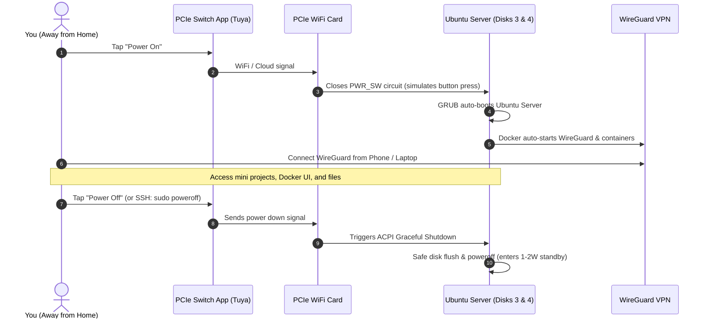

# Project Janus: Hybrid Gaming & On-Demand Home Server

> *Named after **Janus**, the Roman god of duality and transitions, looking simultaneously toward high-performance Windows gaming and a rock-solid, on-demand Ubuntu home server.*

A documentation repository and operational guide for running a dual-purpose personal computer that operates as a **100% isolated Dual-Boot machine**:
* **Face 1 (Gaming)**: High-performance Windows Gaming Rig (Disks 1 & 2).
* **Face 2 (Server)**: On-Demand **Ubuntu Server 24.04 LTS** (Hostname: `janus`, Disks 3 & 4), remotely powered via an internal **WETEN PCIe WiFi Remote Power Switch** and secured through a self-hosted **WireGuard VPN**.

---

## 💻 Hardware Specifications

| Component | Model | Role in Server & Gaming |
| :--- | :--- | :--- |
| **CPU** | Intel Core i7-8700K (6C/12T, 4.5 GHz) | Fast container execution + Intel QuickSync hardware transcoding. |
| **GPU** | ASUS ROG Strix RTX 2070 (8GB VRAM) | Windows Gaming + Linux CUDA acceleration for AI models up to 8B params. |
| **Motherboard** | ASUS PRIME Z370-A | Intel I219-V Gigabit LAN + dedicated PCIe slots for WiFi power switch. |
| **RAM** | 40 GB DDR4 3200 MHz | Massive memory pool for multitasking 15+ containers & in-memory databases. |
| **Storage 1 (NVMe)**| WD Blue SN570 1TB (~931 GB) | **Windows 10/11 Gaming & Personal OS** (100% Isolated / Untouched). |
| **Storage 2 (SSDs)**| BLUERAY (224GB) + Samsung 850 EVO (233GB)| **Joined into single ~456 GB LVM Volume** (Ubuntu Server, Coolify, Docker).|
| **Storage 3 (HDD)** | SAMSUNG HD103SJ 1TB (~931 GB) | **Server Cold Storage & Local Backups** (`/data/storage`). |

*Detailed pinout and hardware analysis: [**Hardware Specs & Motherboard Guide**](docs/hardware-specs.md)*.

---

## 🛠️ Step-by-Step Implementation Guides

### 🚦 Build Progress Status
| Guide | Component / Scope | Status | Verified Endpoints / Details |
| :---: | :--- | :---: | :--- |
| **01** | [Bootable USB](guides/01-create-bootable-usb.md) | ✅ Completed | Ubuntu Server 24.04 LTS flashed with Rufus (GPT) |
| **02** | [Windows & Disks](guides/02-windows-and-disk-preparation.md) | ✅ Completed | Fast Startup disabled, BIOS ErP Ready configured |
| **03** | [OS Install & Partitions](guides/03-ubuntu-server-installation.md) | ✅ Completed | LVM ~456GB, `/boot/efi` isolated, `/data` on HDD |
| **04** | [GPU & Docker](guides/04-post-install-gpu-and-docker.md) | ✅ Completed | Driver 595.99, CUDA 13.2, RTX 2070 container pass-through |
| **05** | [WETEN PCIe Switch](guides/05-remote-switch-weten-setup.md) | ⏳ Hardware Pending | Awaiting WETEN PCIe card delivery; wiring prepared |
| **06** | [WireGuard & DDNS](guides/06-wireguard-vpn-and-infrastructure.md) | ✅ Completed | `your-domain.duckdns.org`, `wg-easy:14` on port 51821 |
| **07** | [Coolify & CI/CD](guides/07-coolify-paas-setup.md) | ✅ Completed | Postgres 18, Redis 7.2, Docmost, Vaultwarden, Org Runner CI/CD |
| **08** | [Monitoring Stack](guides/08-monitoring-and-metrics-setup.md) | ✅ Completed | Uptime Kuma v2 (`status.your-domain`), Netdata GPU metrics |
| **09** | [System Hardening](guides/09-system-hardening-and-maintenance.md) | ✅ Completed | RTC clock sync (`timedatectl`), UFW, Fail2ban, unattended-upgrades |
| **10** | [Automated Backups](guides/10-automated-backups-and-recovery.md) | ✅ Completed | Rclone Crypt AES-256 to 5TB Google Drive, automated snapshots |
| **11** | [JanusDeck Portal](guides/11-janus-deck-command-center.md) | ✅ Completed | Svelte 5 + FastAPI, RTX 2070 telemetry, PIN gate, Windows switch |
| **12** | [Local AI on Coolify](guides/12-local-ai-stack-coolify-setup.md) | ✅ Completed | Ollama + Open WebUI, RTX 2070 GPU pass-through, `ai.your-domain` |
| **13** | [MinIO S3 Storage](guides/13-minio-s3-object-storage-setup.md) | ✅ Completed | Multi-tenant S3 API, per-project IAM isolation, HDD cold storage (`s3.your-domain`) |
| **14** | [New Project Playbook](guides/14-new-project-playbook.md) | ✅ Completed | End-to-end blueprint: shared Postgres, S3, GPU AI, CI/CD, Traefik SSL & monitoring |
| **15** | [RabbitMQ Message Broker](guides/15-rabbitmq-message-broker-setup.md) | ✅ Completed | Centralized AMQP broker, vhost isolation, Management UI (`queue.your-domain`) & Prometheus |
| **16** | [Observability Stack](guides/16-observability-grafana-prometheus-cadvisor.md) | ✅ Completed | Grafana (`grafana.your-domain`), Prometheus, cAdvisor & Loki for per-container CPU/RAM & logs |
| **17** | [Jellyfin Streaming](guides/17-jellyfin-media-streaming.md) | ✅ Completed | Jellyfin PaaS on Coolify, Traefik SSL (`stream.your-domain`), RTX 2070 NVENC, Xiaomi TV ready |
| **18** | [GlitchTip Error Tracking](guides/18-application-error-tracking-glitchtip.md) | ✅ Completed | Lightweight Sentry alternative (`errors.your-domain`), full stack traces & crash alerts |
| **19** | [Network Hardening (Zero Exposure)](guides/19-network-hardening-dns01-and-private-access.md) | ✅ Completed | Closed Ports 80 & 443, DuckDNS DNS-01 SSL challenges, 100% WireGuard-only privacy |
| **20** | [Janus Unified CLI](guides/20-janus-unified-cli.md) | ✅ Completed | Terminal dashboard (`janus status`), 1-click Windows switch, manual backup & log tailing |
| **21** | [GRUB Boot Management](guides/21-grub-boot-management-and-troubleshooting.md) | ✅ Completed | Enforced unattended auto-boot to Ubuntu, GRUB env variable cleanup & dual-boot runbook |

---

### Detailed Walkthroughs:

1. [**Guide 01: Creating the Ubuntu Server Bootable USB**](guides/01-create-bootable-usb.md)
   * Rufus UEFI (GPT) configuration, official ISO download, and safe flashing process.

2. [**Guide 02: Windows & Disk Preparation (Safety Checks)**](guides/02-windows-and-disk-preparation.md)
   * Disabling Windows Fast Startup (`powercfg -h off`) to prevent locked partitions.
   * PowerShell disk mapping to protect Windows drives during installation.
   * ASUS PRIME Z370-A BIOS settings (`ErP Ready: Disabled`, AHCI mode).

3. [**Guide 03: Ubuntu Server Installation & Custom Partitioning**](guides/03-ubuntu-server-installation.md)
   * ASUS F8 boot menu walkthrough.
   * Safe custom storage layout: `/boot/efi` isolation, root on Disk 3, `/data` on Disk 4.
   * OpenSSH setup and initial headless boot verification.

4. [**Guide 04: Post-Install Setup (NVIDIA GPU Drivers & Docker)**](guides/04-post-install-gpu-and-docker.md)
   * 1-command NVIDIA driver setup (`ubuntu-drivers`) and `nvidia-smi` verification.
   * Official Docker CE and Compose plugin installation.
   * NVIDIA Container Toolkit setup for GPU-accelerated Docker containers.
   * Storage permissions and folder structure initialization on `/data`.

5. [**Guide 05: WETEN PCIe Switch Hardware Installation & Pairing**](guides/05-remote-switch-weten-setup.md)
   * Physical card seating in `PCIEX1_4` to maintain full RTX 2070 airflow.
   * ASUS `PANEL` header Y-splitter wiring for `PWR_SW` and `RST_SW`.
   * Tuya / Smart Life app pairing and 433 MHz wireless desk button setup.
   * Verifying remote power-on and safe ACPI shutdowns.

6. [**Guide 06: WireGuard VPN & Remote Access Gateway**](guides/06-wireguard-vpn-and-infrastructure.md)
   * Dynamic DNS (DuckDNS) hostname creation and token setup.
   * Home router UDP port 51820 forwarding and static IP lease.
   * Docker Compose deployment for `wg-easy` (WireGuard VPN with web dashboard).
   * Client QR code generation for iOS/Android and end-to-end remote testing.

7. [**Guide 07: Coolify PaaS Setup & Automated CI/CD**](guides/07-coolify-paas-setup.md)
   * 1-line automated Coolify installer on Ubuntu Server.
   * Central GitHub Organization (`P1gBagPt-Homelab`) and 24/7 self-hosted runner.
   * Automated deployment on push/merge for all homelab projects via Coolify API.
   * 1-click provisioning of shared PostgreSQL 18 and Redis 7 databases.
   * PostgreSQL administration: provisioning dedicated users, databases, and permissions for future apps.
   * Docmost collaborative wiki deployment linked to shared databases.
   * Vaultwarden Bitwarden password manager deployment at `https://vault.your-domain.duckdns.org`.
   * Integrated Traefik reverse proxy and automated Let's Encrypt wildcard SSL.

8. [**Guide 08: Monitoring & Alerting (Uptime Kuma & Netdata)**](guides/08-monitoring-and-metrics-setup.md)
   * Uptime Kuma deployment for service health checks and instant Discord/Telegram phone alerts.
   * Netdata deployment with NVIDIA GPU pass-through for live RTX 2070 VRAM, temps, and load tracking.
   * Per-second CPU package thermals, 40GB RAM utilization, and 4-disk S.M.A.R.T. health.

9. [**Guide 09: System Hardening, Maintenance & Dual-Boot Clock Sync**](guides/09-system-hardening-and-maintenance.md)
   * Dual-boot RTC hardware clock fix (`timedatectl`) to eliminate time desync with Windows.
   * Strict `ufw` firewall policies and `fail2ban` SSH brute-force defense.
   * Automated background security patching via `unattended-upgrades`.
   * Drive S.M.A.R.T. diagnostics, CPU thermal detection (`lm-sensors`), and `btop` CLI dashboard.

10. [**Guide 10: Automated Backups & Disaster Recovery**](guides/10-automated-backups-and-recovery.md)
    * Automated 3-2-1 backup pipeline: local daily snapshots on Disk 4 + encrypted sync to **5 TB Google Drive**.
    * PostgreSQL database dumps, Docmost wiki storage, and Docker volumes.
    * Client-side zero-knowledge encryption via Rclone Crypt (Google cannot scan your files).
    * 60-day cloud retention and 5-minute disaster recovery protocol.

11. [**Guide 11: JanusDeck Command Center & Remote Management Portal**](guides/11-janus-deck-command-center.md)
    * Standalone open-source web dashboard built with Svelte 5 + FastAPI deployed via Coolify (`control.your-domain.duckdns.org`).
    * Mandatory master PIN security gate with clipboard paste & password manager autofill.
    * Real-time hardware telemetry streaming: Intel i7-8700K CPU, 40GB RAM, NVMe/HDD storage, and RTX 2070 GPU via SSE.
    * PIN-guarded physical host actions: graceful shutdown, reboot, 5-second abort countdown, and one-click remote switch to Windows gaming mode (`grub-reboot`).
    * Automated CI/CD pipeline triggered by GitHub Actions organization runner directly into Coolify.

12. [**Guide 12: Local AI Stack Deployment on Coolify (Ollama + Open WebUI)**](guides/12-local-ai-stack-coolify-setup.md)
    * Deploying Ollama and Open WebUI as a Docker Compose stack inside Coolify.
    * Passing through the ASUS ROG Strix RTX 2070 GPU using the NVIDIA Container Toolkit.
    * Routing external access to `https://ai.your-domain.duckdns.org` with automatic Let's Encrypt SSL via Traefik.
    * 100% SSD storage configuration (`/data/ai/ollama` and `/data/ai/open-webui`) for instantaneous model cold-starts.
    * Exposing port 11434 for local developer tooling (VS Code Continue.dev coding copilot).

13. [**Guide 13: Self-Hosted S3 Object Storage with MinIO & Project Isolation**](guides/13-minio-s3-object-storage-setup.md)
    * Centralized S3-compatible storage cluster deployed on Coolify with Traefik SSL (`s3.your-domain.duckdns.org` & `minio.your-domain.duckdns.org`).
    * Strict project isolation: dedicated per-project buckets and scoped IAM policies/keys with zero cross-bucket read/write access.
    * High-capacity storage mapping to the 1TB cold storage HDD (`/data/storage/minio`).
    * Ready-to-use connection examples for Node.js (`@aws-sdk/client-s3`), Python (`boto3`), and Docker `.env`.
    * Verified production integration with Docmost wiki for media attachments and file uploads.
    * Nightly encrypted backup integration with Google Drive via Rclone Crypt (Guide 10).

14. [**Guide 14: New Mini-Project Playbook & Centralized Blueprint**](guides/14-new-project-playbook.md)
    * Standardized 10-step checklist for bootstrapping and deploying any new homelab application.
    * Multi-tenant provisioning for shared PostgreSQL 18, Redis 7.2, and MinIO S3.
    * Direct container-to-container GPU acceleration with Ollama (`llama3.1:8b`, RTX 2070).
    * Automated CI/CD on push via GitHub Actions runner, Traefik wildcard SSL, and Uptime Kuma alerts.

15. [**Guide 15: Centralized Message Broker with RabbitMQ**](guides/15-rabbitmq-message-broker-setup.md)
    * Central AMQP message broker deployment on Coolify (`https://queue.your-domain.duckdns.org`).
    * Virtual Host (`vhost`) and user isolation for multi-tenant microservices.
    * Producer/Consumer examples for Python (`pika`) and Node.js (`amqplib`).
    * Native Prometheus metrics exporter integration on port 15692.

16. [**Guide 16: Centralized Observability Stack (Grafana, Prometheus, cAdvisor & Loki)**](guides/16-observability-grafana-prometheus-cadvisor.md)
    * Unified observability dashboard at `https://grafana.your-domain.duckdns.org`.
    * Prometheus time-series scraping for cAdvisor, RabbitMQ, and mini-project `/metrics`.
    * Google cAdvisor per-container CPU & RAM profiling.
    * Grafana Loki & Promtail for timestamp-aligned container log queries and error correlation.

17. [**Guide 17: Jellyfin Media Streaming & Hardware Transcoding**](guides/17-jellyfin-media-streaming.md)
    * Open-source personal Netflix/media server setup on Docker via Coolify.
    * High-speed metadata and cache on SSD pool + video storage on 1TB HDD (`/data/storage/media`).
    * RTX 2070 NVIDIA NVENC hardware transcoding configuration (or i7-8700K QuickSync).
    * Xiaomi Google TV setup with official Android TV app and LAN auto-discovery.

18. [**Guide 18: Application Error & Crash Tracking with GlitchTip (Sentry)**](guides/18-application-error-tracking-glitchtip.md)
    * Lightweight open-source Sentry alternative deployed on Coolify (https://errors.your-domain.duckdns.org).
    * Captures runtime crashes, in-memory variable dumps, and line-by-line call stacks across Python, Node.js, and .NET.
    * Uses shared PostgreSQL 18 and Redis 7.2 (<250 MB RAM vs 16GB for official Sentry).
    * Discord/Telegram alert integration for immediate critical incident notifications.

19. [**Guide 19: Network Hardening — Transition to Zero Public Exposure (DNS-01 SSL & WireGuard-Only)**](guides/19-network-hardening-dns01-and-private-access.md)
    * Complete elimination of public web attack vectors: Router ports 80 and 443 permanently closed.
    * Automated Let's Encrypt Wildcard SSL certificates provisioned via DuckDNS DNS-01 API challenges (zero inbound web traffic required).
    * 100% stealth homelab perimeter: Only silent WireGuard UDP 51820 is open, dropping unauthenticated scans without responding.
    * Penetration test runbook and one-click rollback procedures.

20. [**Guide 20: Janus Unified CLI — Terminal Command Center**](guides/20-janus-unified-cli.md)
    * Single command interface (`/usr/local/bin/janus`) wrapping Docker, UFW, NVIDIA telemetry, and GRUB.
    * Real-time hardware telemetry dashboard (`janus status`) with colored usage bars for CPU, 40GB RAM, NVMe/HDD storage, and RTX 2070 GPU VRAM.
    * Safe dual-boot switch (`janus to-windows`), manual backup triggers (`janus backup`), and fuzzy container log tailing (`janus logs <service>`).

21. [**Guide 21: GRUB Boot Management & Remote Dual-Boot Runbook**](guides/21-grub-boot-management-and-troubleshooting.md)
    * Permanent enforcement of headless auto-boot into Ubuntu Server on remote power-on.
    * Preventing sticky Windows boot selection caused by `GRUB_SAVEDEFAULT` or cached `grubenv` flags.
    * Troubleshooting matrix for UEFI boot priority, `os-prober`, and one-shot `grub-reboot` workflows.

---

## 📌 Architecture Highlights

* **Isolation Level**: Complete hardware disk segregation.
  * **Disks 1 & 2 (NTFS)**: Windows 10/11 OS, games, and daily personal apps.
  * **Disks 3 & 4 (ext4/ZFS)**: Dedicated Ubuntu Server 24.04 LTS, Docker containers, and storage pool. Windows cannot read or modify these filesystems natively.
* **Boot Management**: GRUB configured to auto-boot to **Ubuntu Server** on remote power-on, with `grub-reboot` support for one-shot remote boots into Windows.
* **Remote Power Control**: Internal **PCIe WiFi Power Switch Card** (WETEN JH-PcPro) connected to ASUS `PANEL` header `PWR_SW` pins. Provides safe one-tap ACPI graceful shutdowns and instant remote turn-ons.
* **Network & Remote Access (Zero Public Exposure)**: Self-hosted WireGuard VPN (via `wg-easy` container) + Dynamic DNS (DDNS). Ports 80 & 443 are **closed** on the router; all internal web services get valid Let's Encrypt SSL via DuckDNS DNS-01 challenges. Silent perimeter against internet botnets.
* **Application & Monitoring Platform**: **Coolify PaaS** for Vercel-like Git-push deployments, 1-click PostgreSQL/Redis databases, Docmost wiki, **Uptime Kuma** alerts, and **Netdata** hardware/RTX 2070 telemetry.

---

## 📚 Technical Documentation Index

1. [**Hardware Specifications & Motherboard Guide**](docs/hardware-specs.md)
   * ASUS PRIME Z370-A `PANEL` header pinout for PCIe switch wiring.
   * RTX 2070 8GB VRAM capabilities for local AI models (Llama 3.1 8B, Mistral 7B).
   * Intel QuickSync hardware transcoding overview.

2. [**Shopping & Hardware Checklist**](docs/06-shopping-and-hardware-checklist.md)
   * Explaining the difference between the existing TP-Link Archer T4E and the PCIe smart switch.
   * WETEN JH-PcPro validated model specs and Vinted reference.
   * Slot layout on ASUS PRIME Z370-A to preserve GPU cooling.

3. [**Ubuntu Server 24.04 LTS Installation & Dual-Boot Guide**](docs/07-os-installation-and-dualboot-guide.md)
   * Safe custom storage partitioning to ensure Windows drives remain untouched.
   * Dedicated `/boot/efi` isolation on Server Disk 3.
   * Automated 1-command NVIDIA driver setup (`ubuntu-drivers`) and official Docker installation.

4. [**01. Power & Remote Management**](docs/01-power-and-remote-control.md)
   * PCIe WiFi switch architecture, wiring, and pin headers (`PWR_SW`).
   * One-tap ACPI graceful shutdowns vs unsafe power cuts.
   * Emergency long-press/reset for frozen machines.

5. [**02. Storage & Disk Allocation**](docs/02-storage-and-disk-architecture.md)
   * 4-Drive partitioning and physical isolation.
   * Redundancy strategies (Mirror / RAID 1 / ZFS mirror / JBOD + backup).
   * Filesystem choices and drive health protection.

6. [**03. Dual-Boot Architecture & OS Isolation Guide**](docs/03-operating-system-and-workflow.md)
   * Complete cross-OS disk isolation (ext4/ZFS invisible to Windows).
   * Disabling Windows Fast Startup (`powercfg -h off`) to avoid locked disk state.
   * Headless auto-boot to Linux Server and remote one-time boot to Windows via `grub-reboot`.

7. [**04. Remote Access & WireGuard VPN Setup**](docs/04-remote-access-and-networking.md)
   * Public IP & DDNS configuration.
   * Docker `docker-compose.yml` deployment for `wg-easy` (web dashboard + QR code clients).
   * End-to-end on-demand lifecycle diagram and remote SSH/App shutdown workflows.

8. [**05. Docker Environment & Mini-Projects Architecture**](docs/05-docker-and-projects-environment.md)
   * Structured directory layout for Docker Compose stacks on dedicated server storage.
   * Core infrastructure (Dockge manager & Nginx Proxy Manager).
   * Mini-project template with isolated database containers.
   * Future AI readiness: NVIDIA Container Toolkit for running GPU-accelerated LLMs (Ollama + Open-WebUI).

9. [**08. Local AI Strategy, Architecture & Management Guide**](docs/08-local-ai-strategy-and-stack.md)
   * Multi-layer homelab AI stack: Inference engines (Ollama, vLLM), routing (LiteLLM), and interfaces (Open WebUI).
   * Hardware capability matrix for RTX 2070 (8GB VRAM) and 40GB RAM.
   * Top homelab AI projects: Private ChatGPT with RAG, VS Code Continue.dev copilot, n8n automation agents, and Immich media indexing.
   * Production Docker Compose blueprints and VRAM management strategies.

---

## ⚡ Remote Operational Lifecycle

---

## 📄 License

This project is licensed under the [MIT License](LICENSE) - feel free to adapt these guides, architecture patterns, and automation scripts for your own homelab setup.
