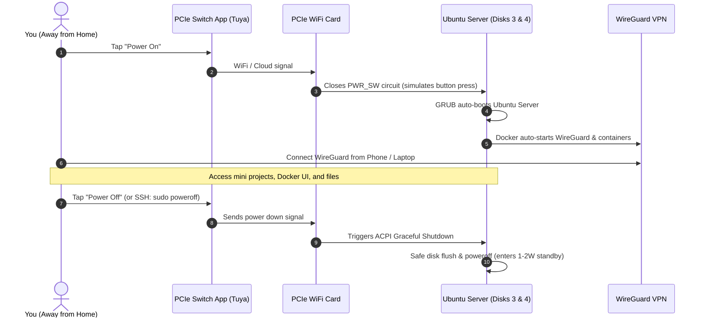

# Hybrid Gaming & On-Demand Home Server (Dual-Boot)

A documentation repository and operational guide for running a dual-purpose personal computer that operates as a **100% isolated Dual-Boot machine**:
* **Mode 1**: High-performance Windows Gaming Rig (Disks 1 & 2).
* **Mode 2**: On-Demand **Ubuntu Server 24.04 LTS** (Disks 3 & 4), remotely powered via an internal **PCIe WiFi Remote Power Switch** and secured through a self-hosted **WireGuard VPN**.

---

## 💻 Hardware Specifications

| Component | Model | Role in Server & Gaming |
| :--- | :--- | :--- |
| **CPU** | Intel Core i7-8700K (6C/12T, 4.5 GHz) | Fast container execution + Intel QuickSync hardware transcoding. |
| **GPU** | ASUS ROG Strix RTX 2070 (8GB VRAM) | Windows Gaming + Linux CUDA acceleration for AI models up to 8B params. |
| **Motherboard** | ASUS PRIME Z370-A | Intel I219-V Gigabit LAN + dedicated PCIe slots for WiFi power switch. |
| **RAM** | 40 GB DDR4 3200 MHz | Massive memory pool for multitasking 15+ containers & in-memory databases. |
| **Storage** | 4 Physical Disks | 2 Disks dedicated to Windows/Games; 2 Disks dedicated to Server OS & data. |

*Detailed pinout and hardware analysis: [**Hardware Specs & Motherboard Guide**](docs/hardware-specs.md)*.

---

## 🛠️ Step-by-Step Implementation Guides

Actionable, step-by-step walkthroughs to set up the system from scratch:

1. [**Guide 01: Creating the Ubuntu Server Bootable USB**](guides/01-create-bootable-usb.md)
   * Rufus UEFI (GPT) configuration, official ISO download, and safe flashing process.

2. [**Guide 02: Windows & Disk Preparation (Safety Checks)**](guides/02-windows-and-disk-preparation.md)
   * Disabling Windows Fast Startup (`powercfg -h off`) to prevent locked partitions.
   * PowerShell disk mapping to protect Windows drives during installation.
   * ASUS PRIME Z370-A BIOS settings (`ErP Ready: Disabled`, AHCI mode).

3. [**Guide 03: Ubuntu Server Installation & Custom Partitioning**](guides/03-ubuntu-server-installation.md)
   * ASUS F8 boot menu walkthrough.
   * Safe custom storage layout: `/boot/efi` isolation, root on Disk 3, `/data` on Disk 4.
   * OpenSSH setup and initial headless boot verification.

4. [**Guide 04: Post-Install Setup (NVIDIA GPU Drivers & Docker)**](guides/04-post-install-gpu-and-docker.md)
   * 1-command NVIDIA driver setup (`ubuntu-drivers`) and `nvidia-smi` verification.
   * Official Docker CE and Compose plugin installation.
   * NVIDIA Container Toolkit setup for GPU-accelerated Docker containers.
   * Storage permissions and folder structure initialization on `/data`.

5. [**Guide 05: WETEN PCIe Switch Hardware Installation & Pairing**](guides/05-remote-switch-weten-setup.md)
   * Physical card seating in `PCIEX1_4` to maintain full RTX 2070 airflow.
   * ASUS `PANEL` header Y-splitter wiring for `PWR_SW` and `RST_SW`.
   * Tuya / Smart Life app pairing and 433 MHz wireless desk button setup.
   * Verifying remote power-on and safe ACPI shutdowns.

6. [**Guide 06: WireGuard VPN & Core Infrastructure Setup**](guides/06-wireguard-vpn-and-infrastructure.md)
   * Dynamic DNS (DuckDNS) hostname creation and token setup.
   * Home router UDP port 51820 forwarding and static IP lease.
   * Docker Compose deployment for `wg-easy` and `dockge` project manager.
   * Client QR code generation for iOS/Android and end-to-end remote testing.

---

## 📌 Architecture Highlights

* **Isolation Level**: Complete hardware disk segregation.
  * **Disks 1 & 2 (NTFS)**: Windows 10/11 OS, games, and daily personal apps.
  * **Disks 3 & 4 (ext4/ZFS)**: Dedicated Ubuntu Server 24.04 LTS, Docker containers, and storage pool. Windows cannot read or modify these filesystems natively.
* **Boot Management**: GRUB configured to auto-boot to **Ubuntu Server** on remote power-on, with `grub-reboot` support for one-shot remote boots into Windows.
* **Remote Power Control**: Internal **PCIe WiFi Power Switch Card** (WETEN JH-PcPro) connected to ASUS `PANEL` header `PWR_SW` pins. Provides safe one-tap ACPI graceful shutdowns and instant remote turn-ons.
* **Remote Access**: Self-hosted WireGuard VPN (via `wg-easy` container) + Dynamic DNS (DDNS). No third-party network relays required.
* **Workload Stack**: Docker & Docker Compose for self-hosted mini-projects with Dockge/Nginx Proxy Manager, prepped for GPU-accelerated local AI (Ollama/WebUI).

---

## 📚 Technical Documentation Index

1. [**Hardware Specifications & Motherboard Guide**](docs/hardware-specs.md)
   * ASUS PRIME Z370-A `PANEL` header pinout for PCIe switch wiring.
   * RTX 2070 8GB VRAM capabilities for local AI models (Llama 3.1 8B, Mistral 7B).
   * Intel QuickSync hardware transcoding overview.

2. [**Shopping & Hardware Checklist**](docs/06-shopping-and-hardware-checklist.md)
   * Explaining the difference between the existing TP-Link Archer T4E and the PCIe smart switch.
   * WETEN JH-PcPro validated model specs and Vinted reference.
   * Slot layout on ASUS PRIME Z370-A to preserve GPU cooling.

3. [**Ubuntu Server 24.04 LTS Installation & Dual-Boot Guide**](docs/07-os-installation-and-dualboot-guide.md)
   * Safe custom storage partitioning to ensure Windows drives remain untouched.
   * Dedicated `/boot/efi` isolation on Server Disk 3.
   * Automated 1-command NVIDIA driver setup (`ubuntu-drivers`) and official Docker installation.

4. [**01. Power & Remote Management**](docs/01-power-and-remote-control.md)
   * PCIe WiFi switch architecture, wiring, and pin headers (`PWR_SW`).
   * One-tap ACPI graceful shutdowns vs unsafe power cuts.
   * Emergency long-press/reset for frozen machines.

5. [**02. Storage & Disk Allocation**](docs/02-storage-and-disk-architecture.md)
   * 4-Drive partitioning and physical isolation.
   * Redundancy strategies (Mirror / RAID 1 / ZFS mirror / JBOD + backup).
   * Filesystem choices and drive health protection.

6. [**03. Dual-Boot Architecture & OS Isolation Guide**](docs/03-operating-system-and-workflow.md)
   * Complete cross-OS disk isolation (ext4/ZFS invisible to Windows).
   * Disabling Windows Fast Startup (`powercfg -h off`) to avoid locked disk state.
   * Headless auto-boot to Linux Server and remote one-time boot to Windows via `grub-reboot`.

7. [**04. Remote Access & WireGuard VPN Setup**](docs/04-remote-access-and-networking.md)
   * Public IP & DDNS configuration.
   * Docker `docker-compose.yml` deployment for `wg-easy` (web dashboard + QR code clients).
   * End-to-end on-demand lifecycle diagram and remote SSH/App shutdown workflows.

8. [**05. Docker Environment & Mini-Projects Architecture**](docs/05-docker-and-projects-environment.md)
   * Structured directory layout for Docker Compose stacks on dedicated server storage.
   * Core infrastructure (Dockge manager & Nginx Proxy Manager).
   * Mini-project template with isolated database containers.
   * Future AI readiness: NVIDIA Container Toolkit for running GPU-accelerated LLMs (Ollama + Open-WebUI).

---

## ⚡ Remote Operational Lifecycle

