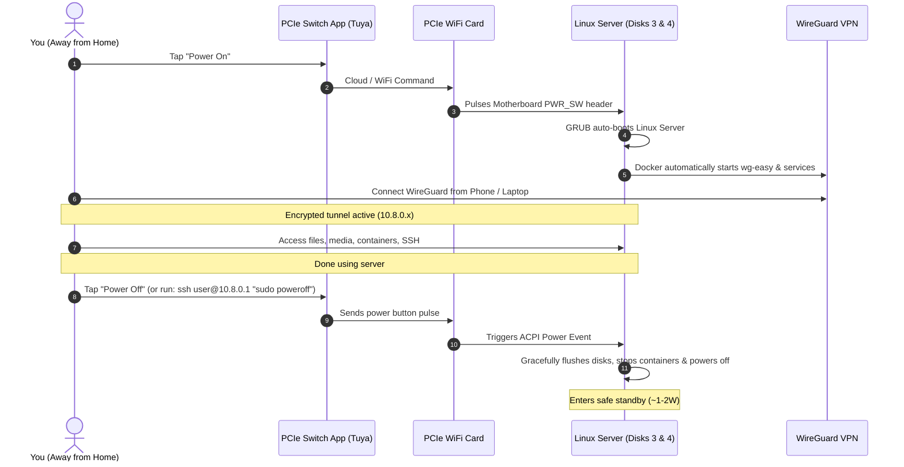

# 04. Remote Access & WireGuard VPN Setup

To manage your on-demand server securely without relying on third-party relay networks (like Tailscale), you will deploy a self-hosted **WireGuard VPN** directly on your Linux Server OS.

---

## 1. Network Requirements & Prerequisites

Before setting up WireGuard, ensure your home network satisfies these conditions:

1. **Public IP / CGNAT Check**:
   * Log into your home router and compare its WAN IP address with what you see on [whatismyipaddress.com](https://whatismyipaddress.com).
   * If both match (and the WAN IP does **not** begin with `100.64.x.x` through `100.127.x.x`), you have a real public IP and can host WireGuard directly.
   * If your ISP uses CGNAT (Carrier-Grade NAT), incoming ports cannot be opened without requesting a public IPv4 from your ISP or using an IPv6 address.
2. **Dynamic DNS (DDNS)**:
   * Most residential internet connections change IP addresses periodically.
   * Register a free DDNS hostname (e.g., [DuckDNS](https://www.duckdns.org) or [No-IP](https://www.noip.com)) so your WireGuard client always finds your home router (e.g., `your-domain.duckdns.org`).
3. **Router Port Forwarding (Vodafone Smart Router)**:
   * Switch router mode to **Modo Expert**.
   * Under **Internet** → **Port Mapping**, create a rule for device **`janus`**:
     * Protocol: **UDP**
     * Public Port / LAN Port: **`51820`**
     * External Source IP: *Leave blank* (allows connections from any outside network)

---

## 2. Deploying WireGuard on the Server

The cleanest, most maintainable method is running **`wg-easy`** via Docker on your Linux Server. It provides an embedded WireGuard server with a responsive web dashboard to generate client `.conf` files and mobile QR codes in seconds.

### `docker-compose.yml` for WireGuard Easy:

Generate your bcrypt hash with `docker run --rm -it ghcr.io/wg-easy/wg-easy wgpw 'YourPassword'` and save it to `.env` (`PASSWORD_HASH='$2a$12$...'`):

```yaml
services:
  wg-easy:
    image: ghcr.io/wg-easy/wg-easy:14
    container_name: wg-easy
    restart: unless-stopped
    environment:
      # Your Dynamic DNS domain or public IP
      - WG_HOST=your-domain.duckdns.org
      # Web UI Password Hash (loaded from .env to prevent $ expansion issues)
      - PASSWORD_HASH=${PASSWORD_HASH}
      # WireGuard Port
      - WG_PORT=51820
      # Web UI Port
      - WG_DEVICE=eth0
      - WG_DEFAULT_ADDRESS=10.8.0.x
      - WG_DEFAULT_DNS=1.1.1.1,8.8.8.8
      - WG_ALLOWED_IPS=192.168.1.0/24, 10.8.0.0/24
    volumes:
      - /data/volumes/wireguard:/etc/wireguard
    ports:
      - "51820:51820/udp"
      - "51821:51821/tcp"
    cap_add:
      - NET_ADMIN
      - SYS_MODULE
    sysctls:
      - net.ipv4.conf.all.src_valid_mark=1
      - net.ipv4.ip_forward=1
```

### Launching:
```bash
sudo docker compose up -d
```
1. Open your browser to `http://192.168.1.68:51821`.
2. Log in with your password.
3. Click **"New Client"** (e.g., *Phone*, *Laptop*).
4. Scan the QR code with the official **WireGuard app** on iOS/Android, or download the configuration file for your laptop.

---

## 3. Remote Operations Workflow (On-Demand Use)

Combining the **PCIe WiFi card** with **WireGuard** provides a seamless on-demand lifecycle:



---

## 4. Remote Shutdown Options

You have two simple ways to turn the machine off cleanly:

1. **Option A: One-Tap App Shutdown (Recommended)**:  
   Tap **"Power Off"** in the Tuya / Smart Life app. The PCIe card signals the motherboard, triggering ACPI graceful powerdown in Linux or Windows.
2. **Option B: Terminal Command over WireGuard**:  
   From a laptop or mobile SSH client (e.g., Termius):
   ```bash
   ssh daniel@10.8.0.1 "sudo systemctl poweroff"
   ```
