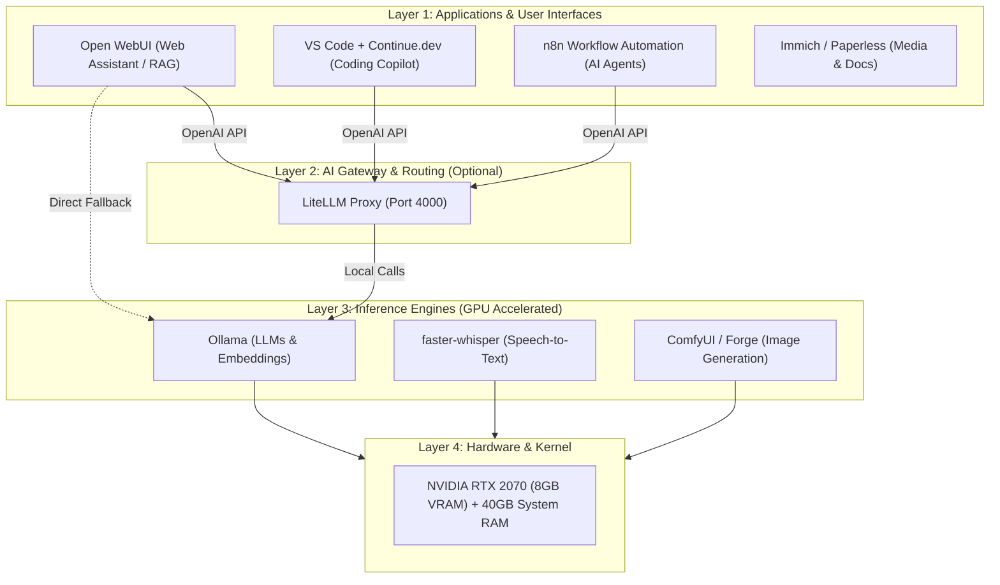

# 08. Local AI Strategy, Architecture & Management Guide

> **Project Janus Local Artificial Intelligence Stack**  
> *Architectural reference and deployment guide for hosting private, GPU-accelerated AI models, orchestration gateways, and developer tools on the Janus home server.*

---

## 1. Executive Summary & Hardware Fit

Project Janus is equipped with hardware uniquely suited for hosting powerful modern open-weights artificial intelligence models:

* **GPU**: ASUS ROG Strix NVIDIA RTX 2070 (**8 GB GDDR6 VRAM**, 2304 CUDA Cores).
* **RAM**: **40 GB DDR4 3200 MHz** (Massive unified memory pool for hybrid CPU offloading).
* **CPU**: Intel Core i7-8700K (6 Cores / 12 Threads, up to 4.5 GHz).
* **OS & Environment**: Ubuntu Server 24.04 LTS with official NVIDIA Driver 595.xx + NVIDIA Container Toolkit configured and verified in Docker.
* **Storage**: `/data/ai` mounted on dedicated high-speed server storage.

---

## 2. The Modern Homelab AI Architecture

The industry-standard way to manage and serve AI on home servers decouples into three distinct operational layers:



### The Three Layers Explained:

1. **Inference Backend (The Execution Engine)**:
   * **Ollama**: The undisputed standard for homelabs. Runs inside Docker, exposes an OpenAI-compatible REST API (`http://localhost:11434/v1`), automatically downloads GGUF models from its registry, and handles VRAM memory swapping.
   * **vLLM**: Production-grade serving with PagedAttention and continuous batching. Ideal when many concurrent users hit the server at once, but consumes all VRAM statically.
   * **ComfyUI**: Node-based pipeline engine for Stable Diffusion and FLUX image generation.

2. **Model Gateway / Routing Layer (LiteLLM)**:
   * Acts as a single unified proxy (`http://janus:4000/v1`).
   * Routes light tasks (summaries, code completions) to the local RTX 2070 for \$0.
   * Seamlessly falls back to cloud models (Claude, Gemini, OpenAI) for ultra-complex prompts.
   * Provides unified token tracking, cost control, and rate limiting.

3. **Application & Interface Layer**:
   * **Open WebUI**: Rich web interface providing multi-user accounts, model switching, document RAG, web search integration, and voice chat.
   * **Continue.dev**: Extension for VS Code providing a free, 100% private GitHub Copilot alternative.

---

## 3. Hardware Capability & Model Sizing Matrix

With **8 GB VRAM** and **40 GB System RAM**, Janus falls into two performance tiers:

| Tier | Model Categories | Quantization | Placement | Expected Speed | Use Cases |
| :--- | :--- | :---: | :--- | :---: | :--- |
| **Tier 1: Full GPU Offload** *(Instant & Snappy)* | • **Qwen 2.5 7B**<br>• **Llama 3.1 8B**<br>• **Qwen 2.5 Coder 7B**<br>• **Mistral 7B v0.3** | `Q4_K_M`<br>`Q5_K_M` | **100% in 8GB VRAM** | **35 – 55 tok/sec** | Daily conversational chat, real-time code autocomplete, reasoning, RAG search. |
| **Tier 2: Hybrid Offload** *(Deep Thinking / High Capacity)* | • **Qwen 2.5 14B**<br>• **DeepSeek-R1-Distill 14B**<br>• **Command-R 35B** | `Q4_K_M` | **~50% VRAM + 40GB DDR4 RAM** | **6 – 15 tok/sec** | Complex logic, multi-page document synthesis, difficult code refactoring. |
| **Audio Intelligence** | • **faster-whisper** (`large-v3-turbo`) | `float16` / `int8` | **GPU VRAM (~2 GB)** | **15x – 25x realtime** | Transcribing hour-long podcasts, meetings, or voice memos in 2–3 minutes. |
| **Embeddings & Search** | • **nomic-embed-text**<br>• **bge-m3** | `float16` | **GPU VRAM (~600 MB)** | **Sub-50ms** | Semantic vector search, PDF retrieval in Open WebUI. |
| **Image Generation** | • **SDXL Turbo**<br>• **Stable Diffusion 1.5** | `fp16` / `fp8` | **GPU VRAM (~6 GB)** | **3 – 8 sec / image** | Local creative art and thumbnail generation. |

---

## 4. Top 5 Homelab AI Implementations to Explore

### 1. Private "ChatGPT" with Web Search & Document Knowledge (Open WebUI)
* **What it does**: A private, ad-free web dashboard at `https://ai.your-domain.duckdns.org` (protected by WireGuard / Coolify).
* **Key Features**:
  * Upload PDFs, text docs, or code repos and chat directly against them using local embeddings.
  * Integrate with **SearXNG** or DuckDuckGo for live internet browsing.
  * Multi-user support with chat history syncing across desktop and mobile.

### 2. Zero-Cost, Private Coding Copilot (VS Code + Continue.dev)
* **What it does**: Eliminates the \$10–\$20/month GitHub Copilot subscription and keeps proprietary code completely on-premises.
* **How it works**:
  * Ollama serves `qwen2.5-coder:7b-instruct` or `deepseek-coder:6.7b`.
  * The **Continue** extension in VS Code connects to `http://192.168.1.68:11434` or WireGuard `http://10.8.0.1:11434`.
  * Delivers inline tab autocompletion, docstring generation, code refactoring, and terminal command debugging.

### 3. Autonomous Automation Agents (n8n + Ollama)
* **What it does**: Connects AI models into background workflows without writing code.
* **Examples**:
  * **Server Log Watchdog**: Netdata / Uptime Kuma triggers an n8n webhook on system alerts; Ollama summarizes the stack trace and pushes a clear notification to Discord or Telegram.
  * **Document Triage**: Scanned receipts or emails are automatically extracted, summarized, and saved into organized folders.

### 4. Smart Local Photo & Media Indexing (Immich)
* **What it does**: Self-hosted Google Photos alternative with local machine learning.
* **AI Capability**: Uses the RTX 2070 to run facial recognition and CLIP semantic image search. You can search your library for *"dog playing on the grass at sunset"* without sending photos to Google or Apple.

### 5. Private Voice Assistant (Home Assistant + Whisper + Piper)
* **What it does**: Replaces Amazon Alexa or Google Home with 100% local speech-to-text, LLM intent matching, and text-to-speech.

---

## 5. VRAM Management & Multi-Service Best Practices

Running multiple AI workloads on an 8 GB graphics card requires smart resource allocation:

### 1. Dynamic VRAM Unloading (`OLLAMA_KEEP_ALIVE`)
By default, Ollama unloads a model from GPU VRAM after 5 minutes of inactivity:
```bash
# Keep model in VRAM for 5 minutes after last request, then free VRAM:
OLLAMA_KEEP_ALIVE=5m

# Unload immediately after request (maximizes VRAM for other tasks):
OLLAMA_KEEP_ALIVE=0

# Keep in VRAM permanently (best for dedicated coding server):
OLLAMA_KEEP_ALIVE=-1
```

### 2. Multi-Container Scheduling
Do not run ComfyUI (image generation) and an 8B LLM simultaneously in VRAM. Set up scripts or manual container start/stops, or rely on Ollama's auto-unload before firing up image generation.

### 3. Monitoring VRAM via Netdata
Janus already has **Netdata** monitoring GPU metrics (established in Guide 08). Keep an eye on:
* `nvidia_smi.memory_used`
* GPU temperature and fan speed during sustained model generation.

---

## 6. Ready-to-Deploy Blueprints

For complete step-by-step implementation, see:
👉 [**Guide 12: Local AI Stack Deployment on Coolify (Ollama + Open WebUI)**](../guides/12-local-ai-stack-coolify-setup.md)

### Blueprint A: Coolify / Docker Compose Stack (`ollama` + `open-webui`)

Deploy as a **Docker Compose** resource in Coolify (or directly on host at `/data/ai/docker-compose.yml`):

```yaml
services:
  ollama:
    image: ollama/ollama:latest
    container_name: ollama
    restart: unless-stopped
    ports:
      - "11434:11434" # Exposed to host/LAN for Continue.dev in VS Code
    volumes:
      - /data/ai/ollama:/root/.ollama
    deploy:
      resources:
        reservations:
          devices:
            - driver: nvidia
              count: all
              capabilities: [gpu]
    environment:
      - OLLAMA_KEEP_ALIVE=5m

  open-webui:
    image: ghcr.io/open-webui/open-webui:main
    container_name: open-webui
    restart: unless-stopped
    ports:
      - "3080:8080"
    volumes:
      - /data/ai/open-webui:/app/backend/data
    environment:
      - OLLAMA_BASE_URL=http://ollama:11434
      - WEBUI_SECRET_KEY=janus-ai-super-secret-key-replace-me
    depends_on:
      - ollama
```

* **Coolify Traefik Domain**: `https://ai.your-domain.duckdns.org` with container port `8080`.
* **Direct LAN / WireGuard URL**: `http://192.168.1.68:3080` or `http://10.8.0.1:3080`.

### Quick Commands to Pull Models:
```bash
# General purpose high-speed reasoning (fits 100% in 8GB VRAM)
docker exec -it ollama ollama run llama3.1:8b

# Premier coding model
docker exec -it ollama ollama run qwen2.5-coder:7b

# Embeddings model for document RAG in Open WebUI
docker exec -it ollama ollama pull nomic-embed-text
```

---

### Blueprint B: VS Code `continue.dev` Client Configuration

Add this to your local machine's `~/.continue/config.json`:

```json
{
  "models": [
    {
      "title": "Janus Qwen 2.5 Coder 7B",
      "provider": "ollama",
      "model": "qwen2.5-coder:7b",
      "apiBase": "http://192.168.1.68:11434"
    }
  ],
  "tabAutocompleteModel": {
    "title": "Janus Autocomplete",
    "provider": "ollama",
    "model": "qwen2.5-coder:1.5b-base",
    "apiBase": "http://192.168.1.68:11434"
  }
}
```

---

## 7. Selected Architecture & Decision Summary

* **Active Stack**: **Ollama + Open WebUI** deployed via Docker Compose with direct NVIDIA GPU passthrough.
* **Storage Location**: **100% Fast SSD Storage** (`/data/ai/ollama` and `/data/ai/open-webui`) on the 456 GB LVM SSD pool.
  * *Rationale*: 7B–8B Q4 models take only ~4.5 GB each (12–15 GB total for a full stack). Keeping them on the SSD provides **instant ~8–10s cold starts** vs 1+ minute delays on mechanical HDDs.
* **External Access**: Accessible locally on `http://192.168.1.68:3080` or securely on the road via WireGuard (`http://10.8.0.1:3080`).
* **Future Expansions**: LiteLLM (multi-provider gateway) and Continue.dev (VS Code coding assistant) can plug directly into the running Ollama instance (`:11434`) at any time without reconfiguring the base stack.
