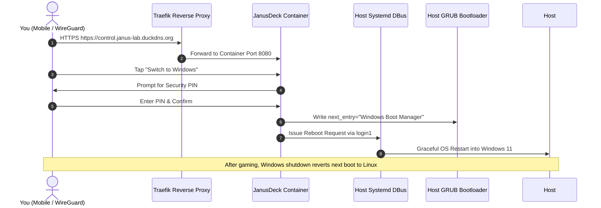

# Guide 11: JanusDeck Command Center & Remote Management Portal

> **Status**: 📋 **Planned / Architecture Finalized**  
> * **Project Repo**: [`janus-deck`](file:///Users/daniel/Desktop/Projects/janus-deck)
> * **Target URL**: `https://control.janus-lab.duckdns.org` (and `http://192.168.1.68:8080`)
> * **Platform**: Coolify PaaS (Docker Compose)
> * **Core Features**: Service Bookmarks, Real-time Hardware Telemetry (RTX 2070, CPU, 40GB RAM), PIN-Guarded Power Controls, and One-Click Reboot to Windows Gaming Mode.

---

## 1. Overview & Purpose

**JanusDeck** is the open-source management portal built specifically for Project Janus's dual-boot architecture. It serves three primary functions:

1. **Central Service Launcher**: A clean, single-screen dashboard with live availability badges for all services hosted on Janus (Coolify, Docmost, Uptime Kuma, Netdata, WireGuard).
2. **Live Hardware Telemetry**: Streams real-time Intel i7-8700K load and thermals, 40GB DDR4 memory usage, NVMe/HDD disk capacity, and ASUS ROG Strix RTX 2070 GPU stats (VRAM, temperature, fan speed).
3. **Remote Dual-Boot & Power Controls**: Securely commands the physical machine to:
   * **Reboot Ubuntu Server** (`systemctl reboot`).
   * **Graceful ACPI Shutdown** (`systemctl poweroff`).
   * **Switch to Windows Gaming Mode** (`grub-reboot "Windows Boot Manager (on /dev/nvme0n1p1)" && reboot`).

---

## 2. Docker to Host Power Bridge Architecture

Because the dashboard runs as a container managed by Coolify, it interfaces with the host system via mounted control sockets:



---

## 3. Coolify Deployment Specification

When ready to deploy on Janus via Coolify:

1. In Coolify, create a new service using **Docker Compose**.
2. Configure environment variables:
   ```env
   JANUS_PIN=your-secret-pin
   TZ=UTC
   ```
3. Use the production Docker Compose configuration from [`janus-deck/docker-compose.example.yml`](file:///Users/daniel/Desktop/Projects/janus-deck/docker-compose.example.yml):
   ```yaml
   services:
     janus-deck:
       image: ghcr.io/daniel/janus-deck:latest # or build from GitHub repository
       container_name: janus-deck
       restart: unless-stopped
       pid: host
       ports:
         - "8080:8080"
       volumes:
         - ./config.yaml:/app/config.yaml:ro
         - /var/run/dbus/system_bus_socket:/var/run/dbus/system_bus_socket:ro
         - /boot:/boot:rw
       deploy:
         resources:
           reservations:
             devices:
               - driver: nvidia
                 count: all
                 capabilities: [gpu]
   ```
4. Assign domain `https://control.janus-lab.duckdns.org` in Coolify to enable automatic Let's Encrypt SSL.

---

## 4. Execution Roadmap Reference

The complete development roadmap and phase breakdown are documented in the standalone repository:
👉 [**JanusDeck Implementation Plan**](file:///Users/daniel/Desktop/Projects/janus-deck/docs/IMPLEMENTATION_PLAN.md)
