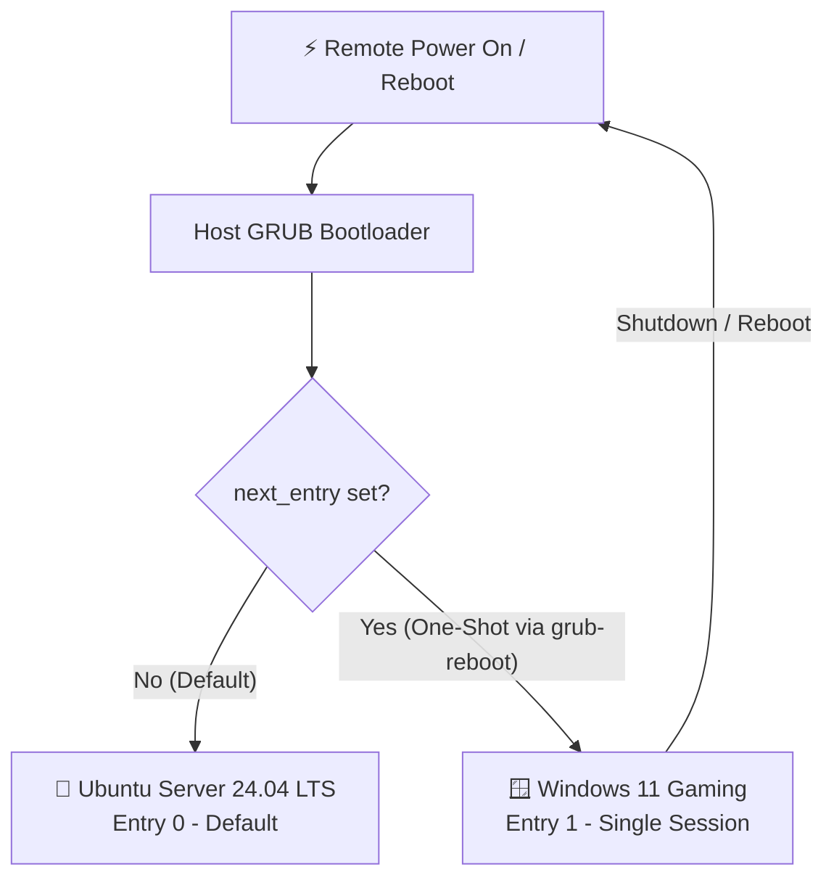

# 21. GRUB Boot Management & Remote Dual-Boot Runbook

> **Target Machine**: `janus` (ASUS PRIME Z370-A, Ubuntu Server 24.04 LTS + Windows 11 Dual-Boot)  
> **Audience**: Homelab Operator / Sysadmin  
> **Status**: ✅ Production Verified

---

## 1. Overview & Operational Goal

Project Janus operates as an on-demand, headless hybrid machine:
* **Default Mode (Homelab Server)**: Boots automatically into **Ubuntu Server 24.04 LTS** when powered on remotely (via WETEN PCIe WiFi switch or smart plug).
* **Secondary Mode (Gaming Rig)**: Boots into **Windows 11** on NVMe (`/dev/nvme0n1p1`) on-demand when requested via the Janus CLI (`janus to-windows`) or JanusDeck.
* **Auto-Revert Guarantee**: Shutting down or restarting Windows must **always** return Janus to Ubuntu unattended.



---

## 2. Root Cause: Why GRUB Defaulted to Windows

If Janus powers on and boots straight into Windows instead of Ubuntu, the issue is typically caused by one of two factors:

1. **`GRUB_SAVEDEFAULT=true` with `GRUB_DEFAULT=saved`**:
   Whenever Windows was selected at the physical desk, GRUB wrote `Windows Boot Manager` into `/boot/grub/grubenv` as the permanent default.
2. **Lingering `saved_entry` in GRUB environment**:
   Even if `/etc/default/grub` is changed, a stored value in `/boot/grub/grubenv` can override defaults until explicitly unset.

---

## 3. Step-by-Step Fix & Permanent Configuration

### Step 1: Identify GRUB Menu Entries
Run the following on `janus` to inspect the available boot entries and their indices:

```bash
grep -E "^menuentry '" /boot/grub/grub.cfg | cut -d"'" -f2
```

**Expected output on Janus:**
```text
Ubuntu                                       <-- Index 0 (Default)
Windows Boot Manager (on /dev/nvme0n1p1)     <-- Index 1 (Gaming)
```

---

### Step 2: Configure `/etc/default/grub`
Update `/etc/default/grub` to enforce `Ubuntu` (`0`) as the permanent boot choice and prevent saving alternative selections:

```bash
sudo sed -i 's/^GRUB_DEFAULT=.*/GRUB_DEFAULT=0/' /etc/default/grub
grep -q '^GRUB_SAVEDEFAULT=' /etc/default/grub \
  && sudo sed -i 's/^GRUB_SAVEDEFAULT=.*/GRUB_SAVEDEFAULT=false/' /etc/default/grub \
  || echo 'GRUB_SAVEDEFAULT=false' | sudo tee -a /etc/default/grub
```

Verify the file contains the following key settings (`sudo nano /etc/default/grub`):

```ini
GRUB_DEFAULT=0
GRUB_TIMEOUT=3
GRUB_TIMEOUT_STYLE=menu
GRUB_SAVEDEFAULT=false
```

---

### Step 3: Clear Stored GRUB Environment Variables
Wipe any cached selection or stale one-shot boot flag in `/boot/grub/grubenv`:

```bash
sudo grub-set-default 0
sudo grub-editenv /boot/grub/grubenv unset next_entry
sudo grub-editenv /boot/grub/grubenv unset saved_entry
```

---

### Step 4: Regenerate GRUB Configuration
Rebuild `/boot/grub/grub.cfg` to apply all changes:

```bash
sudo update-grub
```

**Successful Output:**
```text
Sourcing file `/etc/default/grub'
Generating grub configuration file ...
Found linux image: /boot/vmlinuz-6.8.0-147-generic
Found initrd image: /boot/initrd.img-6.8.0-147-generic
Found Windows Boot Manager on /dev/nvme0n1p1@/efi/Microsoft/Boot/bootmgfw.efi
Adding boot menu entry for UEFI Firmware Settings ...
done
```

---

## 4. Operational Workflows

### A. Switch to Windows from Ubuntu (One-Shot Boot)
Use the Janus CLI:
```bash
janus to-windows
```
Or use native commands:
```bash
# Using entry index 1
sudo grub-reboot 1 && sudo reboot

# Or using explicit entry name
sudo grub-reboot "Windows Boot Manager (on /dev/nvme0n1p1)" && sudo reboot
```
> [!NOTE]
> `grub-reboot` sets a temporary, volatile flag (`next_entry`) in `/boot/grub/grubenv`. GRUB clears this flag as soon as it boots Windows, guaranteeing the next boot goes back to Ubuntu.

### B. Returning to Ubuntu from Windows
When finished gaming:
1. Click **Start > Shut Down** (or `shutdown /s /t 0` in CMD/PowerShell).
2. The next time the computer turns on (locally or remotely), it automatically boots back into **Ubuntu Server**.

---

## 5. Troubleshooting Matrix

| Symptom | Cause | Solution |
| :--- | :--- | :--- |
| **Boots to Windows every restart** | `GRUB_DEFAULT` set to Windows or `saved_entry` cached in `grubenv` | Run `sudo grub-set-default 0` and unset `saved_entry`, then `sudo update-grub`. |
| **PC skips GRUB entirely into Windows** | UEFI boot order changed to prioritize Windows Boot Manager directly | Run `sudo efibootmgr` in Linux or press `Del`/`F2` at boot to set `ubuntu` as Boot Option #1. |
| **Windows locks disks / fast boot issues** | Windows Fast Startup keeps filesystems in hibernation state | In Windows PowerShell (Admin): `powercfg -h off`. |
| **`update-grub` cannot find Windows** | `os-prober` disabled in `/etc/default/grub` | Add `GRUB_DISABLE_OS_PROBER=false` to `/etc/default/grub` and re-run `sudo update-grub`. |

---

## 6. Verification Checklist

- [x] Index `0` is verified as `Ubuntu` (`grep -E "^menuentry '" /boot/grub/grub.cfg`).
- [x] Index `1` is verified as `Windows Boot Manager (on /dev/nvme0n1p1)`.
- [x] `/etc/default/grub` contains `GRUB_DEFAULT=0` and `GRUB_SAVEDEFAULT=false`.
- [x] `grubenv` has `next_entry` and `saved_entry` cleared.
- [x] `sudo update-grub` ran with exit code 0.
- [x] Machine boots to Ubuntu automatically unattended.
