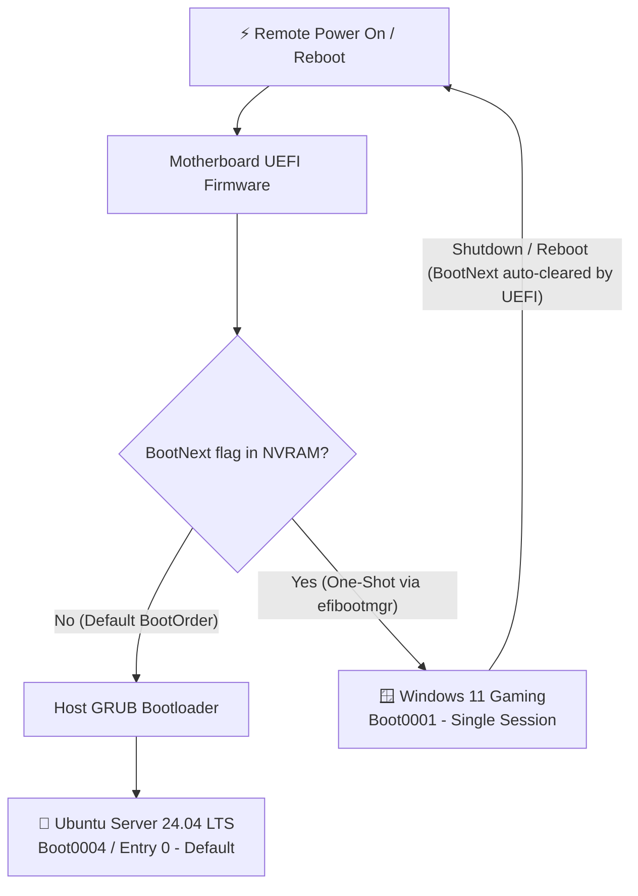

# 21. GRUB Boot Management & Remote Dual-Boot Runbook

> **Target Machine**: `janus` (ASUS PRIME Z370-A, Ubuntu Server 24.04 LTS + Windows 11 Dual-Boot)  
> **Audience**: Homelab Operator / Sysadmin  
> **Status**: ✅ Production Verified

---

## 1. Overview & Operational Goal

Project Janus operates as an on-demand, headless hybrid machine:
* **Default Mode (Homelab Server)**: Boots automatically into **Ubuntu Server 24.04 LTS** when powered on remotely (via WETEN PCIe WiFi switch or smart plug).
* **Secondary Mode (Gaming Rig)**: Boots into **Windows 11** on NVMe (`/dev/nvme0n1p1` / `Boot0001`) on-demand when requested via the Janus CLI or UEFI `BootNext`.
* **Auto-Revert Guarantee**: Shutting down or restarting Windows must **always** return Janus to Ubuntu unattended.



---

## 2. Root Cause: Why GRUB Defaulted to Windows

If Janus powers on and boots straight into Windows instead of Ubuntu, the issue is typically caused by one of three factors:

### 1. Stuck `next_entry` in `grubenv` (GRUB LVM Read-Only Limitation) — *Primary Culprit*
* When switching to Windows via `grub-reboot` or `janus to-windows`, Linux writes `next_entry="Windows Boot Manager..."` to `/boot/grub/grubenv`.
* When the machine reboots, GRUB reads `next_entry` and is supposed to clear it (`save_env next_entry`).
* **The LVM Gotcha**: On Janus, the root filesystem `/` (and `/boot/grub`) lives inside an LVM volume pool (`vg_janus/lv_root`). **GRUB's boot-time LVM diskfilter driver is strictly read-only.**
* GRUB fails to write back to `/boot/grub/grubenv` at boot time. Because it cannot erase the variable, `next_entry` remains stuck in `grubenv` permanently.
* Every single reboot, GRUB reads `next_entry` again and pre-selects Windows.

### 2. `GRUB_SAVEDEFAULT=true` with `GRUB_DEFAULT=saved`
Whenever Windows was manually selected at the physical desk, GRUB saved `Windows Boot Manager` into `/boot/grub/grubenv` as the permanent default.

### 3. Overrides in `/etc/default/grub.d/*.cfg`
Ubuntu 24.04 packages can insert drop-in `.cfg` files into `/etc/default/grub.d/` that silently override settings in `/etc/default/grub`.

---

## 3. Step-by-Step Fix & Permanent Configuration

### Step 1: Clear Stuck GRUB Environment Variables
Inspect and clear any cached selection or stuck one-shot boot flags:

```bash
# 1. Check currently stored variables
sudo grub-editenv /boot/grub/grubenv list

# 2. Clear stuck flags and force default to 0
sudo grub-editenv /boot/grub/grubenv unset next_entry
sudo grub-editenv /boot/grub/grubenv unset saved_entry
sudo grub-set-default 0

# 3. Verify it is clean (should be empty or show saved_entry=0)
sudo grub-editenv /boot/grub/grubenv list
```

---

### Step 2: Configure `/etc/default/grub`
Update `/etc/default/grub` to enforce `Ubuntu` (`0`) as the permanent boot choice and disable saving selections:

```bash
sudo sed -i 's/^GRUB_DEFAULT=.*/GRUB_DEFAULT=0/' /etc/default/grub
grep -q '^GRUB_SAVEDEFAULT=' /etc/default/grub \
  && sudo sed -i 's/^GRUB_SAVEDEFAULT=.*/GRUB_SAVEDEFAULT=false/' /etc/default/grub \
  || echo 'GRUB_SAVEDEFAULT=false' | sudo tee -a /etc/default/grub
```

Verify key settings in `/etc/default/grub`:
```ini
GRUB_DEFAULT=0
GRUB_TIMEOUT=3
GRUB_TIMEOUT_STYLE=menu
GRUB_SAVEDEFAULT=false
```

Check that no drop-in files in `/etc/default/grub.d/` override these settings:
```bash
grep -rn "GRUB_DEFAULT" /etc/default/grub.d/ 2>/dev/null
grep -rn "GRUB_SAVEDEFAULT" /etc/default/grub.d/ 2>/dev/null
```
*(If any matches exist in `/etc/default/grub.d/`, comment them out or remove them).*

---

### Step 3: Regenerate GRUB Configuration
Rebuild `/boot/grub/grub.cfg` to apply all changes:

```bash
sudo update-grub
```

---

### Step 4: Verify UEFI Boot Order
Confirm that Ubuntu is the first boot option in your motherboard UEFI firmware:

```bash
sudo efibootmgr
```

**Verified Janus Output:**
```text
BootCurrent: 0004
Timeout: 1 seconds
BootOrder: 0004,0001,0000,0002,0003,0005
Boot0001* Windows Boot Manager
Boot0004* Ubuntu
```
* `Boot0004` (Ubuntu) is first in `BootOrder`.
* `Boot0001` is Windows Boot Manager.

---

## 4. Operational Workflows

### A. Switch to Windows from Ubuntu (Bulletproof UEFI Method)
Because Janus hosts `/boot` on an LVM pool where GRUB cannot write back to clear `next_entry`, **the recommended and fail-safe method is using UEFI `BootNext`**:

```bash
sudo efibootmgr --bootnext 0001 && sudo reboot
```

#### Why this is bulletproof:
1. **Hardware-Level Switching**: The one-shot boot target is stored directly in motherboard NVRAM, bypassing GRUB entirely.
2. **Auto-Erased by UEFI Specification**: Motherboard firmware automatically erases `BootNext` before launching Windows.
3. **Guaranteed Return to Ubuntu**: When you shut down or reboot Windows, the motherboard falls back to default `BootOrder` (`Boot0004`), bringing you straight back to Ubuntu Server without touching LVM.

---

### B. Returning to Ubuntu from Windows
When finished gaming:
1. Click **Start > Shut Down** (or `shutdown /s /t 0` in CMD/PowerShell).
2. The next time the computer turns on (locally or remotely via WETEN PCIe / smart plug), it automatically boots back into **Ubuntu Server**.

---

## 5. Troubleshooting Matrix

| Symptom | Cause | Solution |
| :--- | :--- | :--- |
| **GRUB highlights Windows on every reboot** | `next_entry=Windows...` stuck in `/boot/grub/grubenv` due to GRUB LVM read-only limitation | Run `sudo grub-editenv /boot/grub/grubenv unset next_entry` and use `sudo efibootmgr --bootnext 0001` for one-shot boots. |
| **Boots to Windows every restart** | `GRUB_DEFAULT` set to Windows or `saved_entry` cached in `grubenv` | Run `sudo grub-set-default 0` and unset `saved_entry`, then `sudo update-grub`. |
| **PC skips GRUB entirely into Windows** | UEFI boot order changed to prioritize Windows Boot Manager directly | Run `sudo efibootmgr -o 0004,0001` in Linux or set `ubuntu` as Boot Option #1 in BIOS. |
| **Windows locks disks / fast boot issues** | Windows Fast Startup keeps filesystems in hibernation state | In Windows PowerShell (Admin): `powercfg -h off`. |
| **`update-grub` cannot find Windows** | `os-prober` disabled in `/etc/default/grub` | Add `GRUB_DISABLE_OS_PROBER=false` to `/etc/default/grub` and re-run `sudo update-grub`. |

---

## 6. Verification Checklist

- [x] Index `0` is verified as `Ubuntu` (`grep -E "^menuentry '" /boot/grub/grub.cfg`).
- [x] UEFI `Boot0004` (Ubuntu) is #1 in `BootOrder` (`sudo efibootmgr`).
- [x] `/etc/default/grub` contains `GRUB_DEFAULT=0` and `GRUB_SAVEDEFAULT=false`.
- [x] `grubenv` has `next_entry` and `saved_entry` cleared (`sudo grub-editenv /boot/grub/grubenv list`).
- [x] `sudo update-grub` ran with exit code 0.
- [x] Remote switch to Windows uses `sudo efibootmgr --bootnext 0001 && sudo reboot`.
- [x] Machine boots to Ubuntu automatically unattended.
